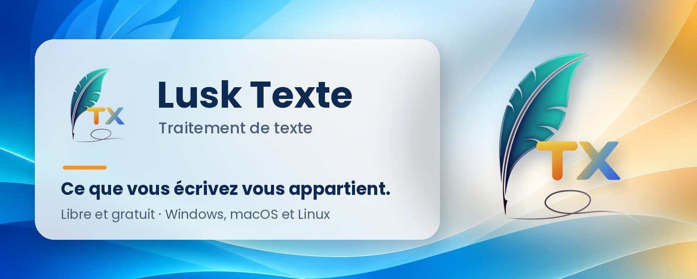

<p align="center">
  
</p>

<h3 align="center">Ce que vous écrivez vous appartient.</h3>

<p align="center">
  Un traitement de texte libre et gratuit, porté par l'association Lusk (loi 1901).<br>
  Pour Windows, macOS et Linux. Sans compte, sans publicité, et vos fichiers restent chez vous.
</p>

<p align="center">
  <a href="https://github.com/declic29/LuskTX/releases/latest/download/Lusk-Texte-Windows.msi"></a>
  <a href="https://github.com/declic29/LuskTX/releases/latest/download/Lusk-Texte-Mac.dmg"></a>
  <a href="https://github.com/declic29/LuskTX/releases/latest/download/Lusk-Texte-Linux.deb"></a>
</p>

<p align="center">
  <a href="https://github.com/declic29/LuskTX/releases/latest"></a>
  
  
  <a href="https://www.lusk.bzh"></a>
</p>

<p align="center">
  <a href="https://www.lusk.bzh"><b>lusk.bzh</b></a> ·
  <a href="https://github.com/declic29/LuskTX/releases">Toutes les versions</a> ·
  <a href="https://github.com/declic29/LuskOffice">Toute la suite avec Lusk Office</a> ·
  <a href="https://github.com/declic29/LuskTX/issues">Signaler un problème</a>
</p>

---

## Lusk Texte en bref

Lusk Texte est un traitement de texte pour Windows, macOS et Linux. Il fonctionne entièrement sur
votre ordinateur : pas de compte, pas de publicité, pas de mesure d'audience, et vos documents ne
sont jamais envoyés nulle part. La page **Aide › Confidentialité** de l'application dit
exactement quand Lusk Texte utilise Internet (pour les mises à jour, et quand vous le lui demandez).

- **Vos fichiers, dans les formats de tout le monde** : Word (.docx, .doc), OpenDocument (.odt),
  RTF, HTML, Markdown, texte ; export PDF.
- **Un traitement de texte complet** : styles, listes, tableaux, en-têtes et pieds de page,
  images et formes, notes, table des matières, bibliographie, suivi des modifications,
  commentaires, publipostage, correcteur orthographique et grammatical, césure française.
- **Le Mode Livre** : la structure d'un roman, d'un essai ou d'un recueil (pages liminaires,
  parties, chapitres), la mise en page d'édition, le studio de couverture, un PDF prêt pour
  l'imprimeur, un EPUB accessible pour les liseuses, un contrôle qualité avant publication et
  l'historique des versions.
- **Des dictionnaires intégrés** : la correction orthographique en **français** (dictionnaire
  Dicollecte) et en **breton** (dictionnaire d'An Drouizig) fonctionne dès l'installation,
  sans rien télécharger, comme celle de l'anglais.
- **En français d'abord**, avec une aide intégrée rédigée pour tous.

## Télécharger et installer

Téléchargez la dernière version pour votre système :

| Système | Téléchargement |
|---|---|
| Windows (64 bits) | [**Lusk-Texte-Windows.msi**](https://github.com/declic29/LuskTX/releases/latest/download/Lusk-Texte-Windows.msi) |
| macOS (Apple et Intel) | [**Lusk-Texte-Mac.dmg**](https://github.com/declic29/LuskTX/releases/latest/download/Lusk-Texte-Mac.dmg) |
| Linux (toutes distributions) | [**Lusk-Texte-Linux.AppImage**](https://github.com/declic29/LuskTX/releases/latest/download/Lusk-Texte-Linux.AppImage) |
| Linux (Debian, Ubuntu, Mint) | [**Lusk-Texte-Linux.deb**](https://github.com/declic29/LuskTX/releases/latest/download/Lusk-Texte-Linux.deb) |

Les autres formats (version portable pour Windows sans installation, `.rpm` pour Fedora et
openSUSE, `.tar.gz`) et les versions précédentes sont sur la page
[Releases](https://github.com/declic29/LuskTX/releases/latest).

`SHA256SUMS.txt` donne l'empreinte de chaque fichier, pour vérifier un téléchargement.

Une fois Lusk Texte installé, **Fichier › Mises à jour** cherche et installe les nouvelles
versions.

**Windows.** L'installeur propose « Pour moi seulement » (pour votre compte, sans droits
d'administrateur, dans `%LOCALAPPDATA%\Programs\Lusk\Lusk Texte`) ou « Pour tous les
utilisateurs de cet ordinateur » (dans `C:\Program Files\Lusk\Lusk Texte`, avec l'accord d'un
administrateur), puis un raccourci sur le Bureau (case cochée au départ).

**macOS.** Ouvrez le `.dmg` et glissez Lusk Texte dans Applications. L'application n'a pas de
certificat Apple : la première fois, macOS la bloque ; ouvrez **Réglages Système › Confidentialité
et sécurité**, puis cliquez sur **Ouvrir quand même**.

**Linux.** Rendez l'AppImage exécutable (`chmod +x`) puis lancez-la, ou installez le paquet de
votre distribution.

### Si Lusk Texte ne démarre pas

- **Windows, la fenêtre n'apparaît pas** : certains pilotes graphiques posent problème. Dans
  PowerShell, depuis le dossier du programme, essayez un autre moteur d'affichage :
  ```powershell
  $env:WGPU_BACKEND = "vulkan"
  & .\wordcraft.exe
  ```
- **Windows, application lente sur un ancien PC** : Lusk Texte choisit lui-même OpenGL quand
  DirectX 12 n'a pas de pilote ; `WGPU_BACKEND` (`gl`, `dx12`, `vulkan`) permet de forcer un choix.
- **Linux sous Wayland** : l'application passe par XWayland (pour le glisser-déposer de fichiers).
  `WORDCRAFT_WAYLAND=1 wordcraft` utilise Wayland directement.
- Le **journal** se trouve dans `%APPDATA%\LuskTexte\logs\` (Windows),
  `~/Library/Application Support/Lusk Texte/logs/` (macOS) ou `~/.config/lusk-texte/logs/`
  (Linux). Joignez-le à un signalement de problème.

## La suite Lusk

Lusk Texte fait partie de la suite libre et gratuite de l'association Lusk. Avec
**[Lusk Office](https://github.com/declic29/LuskOffice)**, un seul programme installe d'un coup les logiciels que vous cochez
(Windows, Linux et Mac).

<table>
  <tr>
    <td width="50%"><a href="https://github.com/declic29/LuskTab"></a></td>
    <td width="50%"><a href="https://github.com/declic29/Lusk-Diapo"></a></td>
  </tr>
  <tr>
    <td width="50%"><a href="https://github.com/declic29/Lusk_Pdf"></a></td>
    <td width="50%"><a href="https://www.lusk.bzh"></a></td>
  </tr>
</table>

## Compiler Lusk Texte

Il faut [Rust](https://rustup.rs) (version stable).

```sh
git clone https://github.com/declic29/LuskTX
cd LuskTX
cargo run --release -p wordcraft -- --sample      # l'application, avec un document d'exemple
cargo run --release -p wordcraft -- rapport.docx  # ouvrir un document
```

L'outil en ligne de commande convertit des documents sans ouvrir l'application :

```sh
wordcraft-cli convert rapport.docx rapport.pdf    # docx, pdf, odt, rtf, html, md, tex, txt, png
```

Avant chaque envoi, `cargo xtask ci` vérifie la mise en forme du code, les tests et les
attributions des images et polices.

## Publier une version

Voir l'en-tête de [`.github/workflows/release.yml`](.github/workflows/release.yml) : on augmente
la version dans `Cargo.toml`, on pousse l'étiquette `v<version>`, GitHub fabrique les installeurs
et prépare la Release en brouillon, qu'on publie après l'avoir testée.

## Licence et origine

Lusk Texte est un logiciel libre, sous licence [MIT](LICENSE-MIT) ou [Apache 2.0](LICENSE-APACHE),
au choix. © 2026 Lusk, association loi 1901.

Lusk Texte est dérivé de WordCraft, Copyright (c) 2026 ArtCraft Team and the WordCraft
contributors, publié sous les mêmes licences. Les mentions obligatoires sont dans
[NOTICE](NOTICE), et l'auteur, la source et la licence de chaque image, police et dictionnaire
sont dans [ATTRIBUTION.md](ATTRIBUTION.md).

Les modèles et documents d'exemple sont des textes originaux. Aucune icône ni image ne provient
de Microsoft Office ou d'un autre logiciel commercial.
